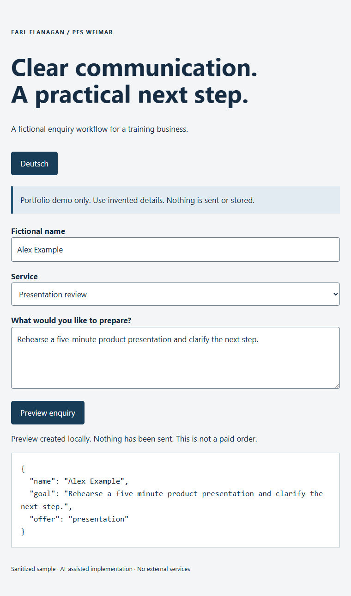

# PES Weimar — business tools and workflow showcase

**Turning business-communication expertise into clear, testable digital workflows.**

## Problem → my contribution → demonstrated result

**Problem:** customers need to understand a training offer, prepare for a business conversation and know what happens next. The business needs usable context without confusing an enquiry, an acknowledgement and an agreed paid engagement.

**My contribution:** I supplied the business direction and training expertise, defined practical user needs, reviewed wording and behaviour, and directed revisions and testing. Skywork performed most of the original development; ChatGPT/Codex supported later implementation, debugging, documentation and automated checks.

**Demonstrated result:** a German/English service workflow and a separate four-tool preparation toolkit. The paid toolkit's **1.1.0 release was delivered and checksum-verified on 1 November 2026**, with tested JSON recovery across all four tools and a supported portable Windows x64 launch mode. See [release verification and limits](docs/bilingual-repair-2026-11-01.md).

## See the public sample

*Actual screenshot of the public demo using invented details. The preview sends and stores nothing; it is not an order or the paid toolkit.*

Download the repository and open `demo/index.html` in your browser. No account, installation or server is required for this fictional sample. Choose English or German, select a service and preview an enquiry.

The [topic and meeting-stage sample](demo/call-prep.html) demonstrates editable fictional preparation suggestions. [Training and editing examples](samples/) provide additional subject-matter context.

## What this demonstrates

- Explaining services and guiding a user to a practical next step.
- Bilingual user guidance, accessible form feedback and input validation.
- Keeping preparation suggestions separate from actual outcomes and agreed actions.
- Distinguishing an enquiry from a paid order, and acknowledgement from delivery.
- Reviewing AI-assisted work, documenting evidence and protecting private material.

Run the public sample checks with Node.js: `node --test tests/*.test.cjs`.

## The stack and its boundaries

The service website uses static HTML, CSS and JavaScript, with Netlify hosting/Forms and a public Cal.com booking route. Enquiry review, proposals and customer decisions remain human-led.

The separate paid workbench contains Evidence Capture, Call Prep, ICP Profiler and Release Checklist. Its supported Windows launcher uses a fixed local address; saved data remains browser-local and requires JSON backups. It is not a shared cloud CRM. Full paid source and the bundled runtime are excluded here.

The public sample was newly assembled with Codex assistance in November 2026. It uses fictional examples and an in-memory preview. It contains no production form endpoint, booking integration, mailbox address, customer record, private analytics or verification token. No production history is included.

See [stack inventory](docs/stack-inventory.md), [architecture](docs/architecture.md) and [case study](docs/case-study.md).

## Evidence you can inspect

- [Current release verification](docs/bilingual-repair-2026-11-01.md): delivery checksum, bilingual interface/guides, backup recovery and Windows launch checks.
- [Workflow improvements](docs/workflow-upgrades.md): current status and clearly dated development history.
- [Evidence timeline](docs/evidence-timeline.md): what each checkpoint establishes.
- [Remaining priorities](docs/stack-roadmap.md): supported scope and outstanding external validation.

Release records distinguish the larger private-product checks from this public sample's smaller tests. They do not establish customer adoption, revenue, conversion uplift, ranking improvement or accessibility certification. My role is business direction, subject-matter expertise and review; AI-assisted implementation should not be read as independent professional software-engineering employment.

## Repository contents

- `demo/`: runnable fictional samples, without external dependencies.
- `src/`: small sample validation and preparation modules.
- `tests/`: focused public-sample checks.
- `samples/`: fictional training and editing examples.
- `docs/`: current release, workflow, attribution and publication boundaries.

No open-source licence is granted. See [NOTICE.md](NOTICE.md); request permission before reusing the materials.
