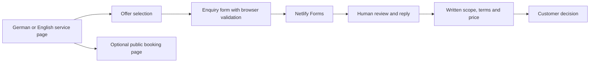

# Workflow and architecture

## Inspected production design

HTML and CSS provide the content and layout. JavaScript trims inputs, preserves allowlisted service choices and provides accessible validation/status text. The production implementation includes a timeout, duplicate-submit guard and an email-text fallback when delivery cannot be confirmed. The site uses Netlify Forms; customer delivery and notifications require separate end-to-end evidence.

## Showcase design

Browser -> local validation module -> on-screen fictional preview.

No network submission, analytics, cookies, browser storage, mailing provider or booking integration. A page refresh clears the input. The absence of external requests is also checked statically. Do not deploy this sample as a real lead form without implementing and validating a separate delivery and privacy design.
